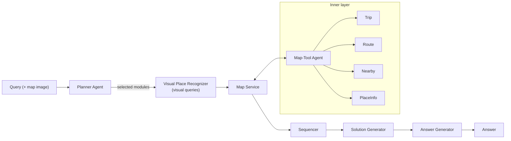

# MapAgent: A Hierarchical Agent for Geospatial Reasoning with Dynamic Map Tool Integration

[](https://aclanthology.org/2026.findings-eacl.67/)


Official implementation of **MapAgent** (Findings of the Association for Computational Linguistics: EACL 2026,
pages 1296–1322) by Md Hasebul Hasan, Mahir Labib Dihan, Tanzima Hashem, Mohammed Eunus Ali and Md Rizwan Parvez.

MapAgent is a hierarchical, plug-and-play multi-agent framework for map-integrated geospatial reasoning. A
**Planner Agent** decomposes a query and selects modules from a module inventory; tool-heavy work is delegated
to a dedicated **Map-Tool Agent** that orchestrates four map tools (Trip, Route, Nearby, PlaceInfo) built on the
Google Maps APIs and calls them in parallel, while light modules (sequencing, solution and answer generation) run
without extra agent overhead. MapAgent is evaluated on MapEval-API, MapEval-Textual, MapEval-Visual and MapQA.

## Contents

- [How MapAgent works](#how-mapagent-works)
- [Installation](#installation)
- [Configuration](#configuration)
- [Running MapAgent](#running-mapagent)
- [Evaluation and outputs](#evaluation-and-outputs)
- [Results reported in the paper](#results-reported-in-the-paper)
- [Datasets](#datasets)
- [Baselines](#baselines)
- [Extending MapAgent](#extending-mapagent)
- [Tests](#tests)
- [Changes compared with the first code release](#changes-compared-with-the-first-code-release)
- [Responsible use](#responsible-use)
- [Citation](#citation)

## How MapAgent works



**Outer layer – Planner Agent and module inventory** (Section 3.3, Table 10). The planner (an LLM, or a VLM
for visual queries) returns the sequence of modules to run:

| Module | Role | Code |
| --- | --- | --- |
| `visual_place_recognizer` | VLM: finds the central place of the map snapshot and estimates its radius | `mapagent/modules.py` |
| `map_service` | Fetches geospatial data through the Map-Tool Agent | `mapagent/modules.py`, `mapagent/map_tools/agent.py` |
| `sequencer` | Organizes the information gathered by the previous modules | `mapagent/modules.py` |
| `solution_generator` | Writes a step-by-step solution (LLM, or VLM for visual queries) | `mapagent/modules.py` |
| `answer_generator` | Verifies the solution and extracts the final answer | `mapagent/modules.py` |

**Inner layer – Map-Tool Agent and MapTools** (Section 3.4, Table 11, Appendix C). The agent selects tools by
function calling. All calls requested in one turn run in parallel; when the results show that more information is
needed (e.g. details of places found by a nearby search) it can call tools again in a further round.

| Tool | Google Maps APIs | Parameters |
| --- | --- | --- |
| `trip` | Places + Place Details + Directions | `current_location`, `visiting_places`, `travel_mode` (default `driving`) |
| `route` | Directions | `origin`, `destination`, `mode`, `waypoints`, `alternatives` |
| `nearby` | Geocoding + Places | `query`, `location`, `type`, `radius` (km, default 20) |
| `place_info` | Places + Place Details | `location_address` |

The prompts of Appendix B are in `mapagent/prompts/`.

### Repository layout

```
MapAgent/
├── run.py                     # run MapAgent on a benchmark or on one task folder
├── evaluate.py                # accuracy per category + cost per query
├── mapagent/
│   ├── solver.py              # Planner Agent and module execution
│   ├── modules.py             # module inventory (Table 10)
│   ├── map_tools/
│   │   ├── agent.py           # Map-Tool Agent (parallel, multi-round function calling)
│   │   ├── tools.py           # Trip, Route, Nearby, PlaceInfo
│   │   └── client.py          # Google Maps client (lazy, counts requests)
│   ├── prompts/               # prompts (Appendix B)
│   ├── llm.py                 # OpenAI / Azure OpenAI / OpenAI-compatible (OpenRouter, vLLM) client
│   ├── data.py                # benchmark presets and loaders
│   ├── scoring.py             # answer extraction, scoring, summaries
│   └── usage.py               # LLM calls, tokens and Google Maps calls per query
├── baselines/octotools/       # OctoTools baseline with the same map tools
├── scripts/prepare_mapqa.py   # how the MapQA problem files were built
├── tests/                     # offline tests (fake LLM and fake Google Maps)
└── datasets_dir/              # MapEval-Textual/API, MapEval-Visual, MapQA
```

## Installation

Python 3.9 or newer.

```bash
git clone https://github.com/Hasebul/MapAgent.git
cd MapAgent
python -m venv .venv && source .venv/bin/activate
pip install -r requirements.txt
cp .env.example .env        # then add your keys
```

## Configuration

Keys are read from environment variables or from a `.env` file at the repository root (never commit it).

| Variable | Used for |
| --- | --- |
| `OPENAI_API_KEY` | OpenAI, or the key of an OpenAI-compatible service (OpenRouter, ...). Use any value (e.g. `EMPTY`) for a local vLLM server. |
| `OPENAI_BASE_URL` | Optional OpenAI-compatible endpoint, e.g. `https://openrouter.ai/api/v1` or `http://localhost:8000/v1` (same as `--base_url`). |
| `MAPAGENT_LLM_PROVIDER` | `openai` (default) or `azure` (same as `--provider`). |
| `AZURE_OPENAI_API_KEY`, `AZURE_OPENAI_ENDPOINT`, `AZURE_OPENAI_API_VERSION` | Azure OpenAI. With Azure, `--model` is the deployment name. |
| `GOOGLE_MAPS_API_KEY` | Map tools. Enable the **Places API**, **Directions API** and **Geocoding API** for the key (recent Google Cloud consoles may list Places and Directions as legacy services). |

The Map-Tool Agent relies on function calling, so the model used for it must support tools (GPT-3.5-Turbo,
GPT-4o, Qwen-2.5 served with tool calling enabled, ...).

## Running MapAgent

A small smoke test (5 questions):

```bash
python run.py --benchmark mapeval_api --tasks trip --limit 5 --model gpt-4o-mini
```

### Paper settings

| Benchmark | Command | Input given to the model |
| --- | --- | --- |
| MapEval-API | `python run.py --benchmark mapeval_api --model gpt-3.5-turbo` | question + options; information comes from Google Maps |
| MapEval-Textual | `python run.py --benchmark mapeval_textual --model gpt-3.5-turbo` | question + options + long textual map context |
| MapEval-Visual | `python run.py --benchmark mapeval_visual --model gpt-4o` | question + options + map snapshot |
| MapQA | `python run.py --benchmark mapqa --model gpt-3.5-turbo` | open-ended question with geo-entity context |

If `--model` is omitted, the paper's backbone is used (GPT-4o for MapEval-Visual, GPT-3.5-Turbo otherwise).

Other backbones from the paper:

```bash
# Qwen-2.5-72B through OpenRouter (OPENAI_API_KEY = your OpenRouter key)
python run.py --benchmark mapeval_api --model qwen/qwen-2.5-72b-instruct --base_url https://openrouter.ai/api/v1

# Qwen-2.5-VL-72B served locally with vLLM (tool calling enabled)
vllm serve Qwen/Qwen2.5-VL-72B-Instruct --enable-auto-tool-choice --tool-call-parser hermes
OPENAI_API_KEY=EMPTY python run.py --benchmark mapeval_visual \
    --model Qwen/Qwen2.5-VL-72B-Instruct --base_url http://localhost:8000/v1

# Azure OpenAI (model = deployment name)
python run.py --benchmark mapeval_api --provider azure --model my-gpt-35-deployment
```

Every LLM role is configured explicitly. `--model` sets all of them; these flags override single roles:

| Role | Flag | What it does |
| --- | --- | --- |
| Planner Agent | `--planner_model` | selects the modules |
| Map-Tool Agent | `--map_agent_model` | native function calling over the four MapTools (must support tools) |
| Visual Place Recognizer | `--vpr_model` | VLM, visual questions only |
| Sequencer | `--sequencer_model` | organizes the retrieved map data |
| Solution Generator | `--sg_model` | step-by-step solution (VLM for visual questions) |
| Answer Generator | `--ag_model` | verifies the solution and extracts the answer |

The resolved model of every role, the provider and endpoint, all arguments and the git revision of the code are
saved in `config.json` of each run, so a result can always be traced back to its exact configuration. There is no
separate Qwen code path: the same code runs any OpenAI-compatible endpoint that supports tool calling.

Base model (no planner, no tools; the "Base Model" rows of Tables 3, 5 and 6):

```bash
python run.py --benchmark mapeval_textual --mode base --model gpt-3.5-turbo
```

### Useful options

| Option | Description |
| --- | --- |
| `--benchmark` / `--data_root` | A preset (`mapeval_api`, `mapeval_textual`, `mapeval_visual`, `mapqa`) or one task folder containing `problems.json`. |
| `--tasks` | Subset of a preset's tasks, e.g. `--tasks poi nearby`. |
| `--split`, `--limit` | `all` (default) or a split from `pid_splits.json` (e.g. `minitest`); number of questions per task. |
| `--mode` | `mapagent` (default) or `base`. |
| `--modules` | Fixed module sequence instead of the planner, e.g. `--modules map_service solution_generator answer_generator`. |
| `--model` | Backbone for every module; override single modules with `--planner_model`, `--map_agent_model`, `--vpr_model`, `--sequencer_model`, `--sg_model`, `--ag_model`. |
| `--answer_generator` | `llm` (default; verify and extract, as in the paper) or `rule` (regex extraction only, one LLM call cheaper). |
| `--map_max_rounds`, `--map_max_workers` | Tool-calling rounds and parallel tool calls of the Map-Tool Agent (defaults 3 and 5). |
| `--use_context`, `--use_image`, `--open_ended` | Override the preset (e.g. `--no-use_context`). |
| `--output_dir`, `--label` | Results go to `<output_dir>/<benchmark>/<label>/` (default label `<mode>_<model>`). |
| `--overwrite`, `--rerun_errors` | Runs resume automatically; start over, or re-run questions that failed. |
| `--verbose` | Print the modules and the prediction of every question. |

Run `python run.py --help` for all options.

## Evaluation and outputs

Each run directory contains:

- `<task>.jsonl` – one record per question: the selected modules, the output of every module (the tool calls of
  the Map-Tool Agent, the retrieved map data, the solution, ...), the prediction, the gold answer, any error, and
  the cost of the question (LLM calls, tokens, MapTool calls, Google Maps requests, time);
- `config.json` – models of every role, provider/endpoint, temperature, all arguments and the git revision;
- `manifest.json` – the question IDs the run covers (per task) and the questions that were skipped and why;
- `summary.json` – the scores.

```bash
python evaluate.py results/mapeval_api/mapagent_gpt-3.5-turbo
```

```
| Metric | Overall | Place Info | Nearby | Routing | Trip | Unanswerable |
|---|---|---|---|---|---|---|
| Accuracy (%) | ... |
Average cost per query: ... LLM calls, ...K tokens, ... MapTool calls, ... Google Maps API calls, ... s
```

### Scoring protocol

Fuzzy similarity is fuzzywuzzy's `fuzz.ratio` (difflib implementation) on lower-cased, whitespace-normalised text,
divided by 100. The threshold is **0.9** (`--fuzzy_threshold`).

- **Multiple choice (MapEval)** – the prediction is resolved to the option it equals or, failing that, to its single
  most similar option if the similarity is at least 0.9 ("Unanswerable" counts as an option). The answer is correct
  if that option is the gold option. Since a prediction is always matched to its *closest* option, a wrong option
  that happens to be 90% similar to the gold one (e.g. "1 hour 3 mins" vs "1 hour 5 mins"; 33 such option pairs
  exist in MapEval) is never accepted.
- **Open-ended (MapQA)** – correct if the extracted answer equals the gold answer after normalisation, contains it
  as a whole phrase, or is at least 0.9 similar to it with the same numbers. Quantities (e.g. `21694.66 meters`)
  are compared numerically with a 5% relative tolerance after unit conversion (`--numeric_tolerance`).
- **Denominators** – every question of the evaluated set counts. Unparseable answers and questions whose run
  failed count as wrong, and questions listed in `manifest.json` without a result count as wrong too
  (`--ignore_missing` reports accuracy over the answered questions only).
- **Aggregation** – per-category accuracy is computed within each category; the overall accuracy is
  micro-averaged over all questions (the macro average over categories is printed as well). A run is a single pass
  at temperature 0 by default (`--temperature`); to average several runs, evaluate each run directory separately.
- `--legacy_fuzzy` reproduces the scorer of the first release (commit `a82eedc`: `fuzz.ratio >= 30` against the gold
  text). It accepts about half of the wrong MapEval options, so use it only to compare with old result files.

`evaluate.py` re-scores the saved predictions, so scoring options can be changed without re-running.

## Results reported in the paper

Overall accuracy (%) of MapAgent and of the strongest baseline, OctoTools (Tables 2, 3, 5 and 6 of the paper):

| Benchmark | Backbone | OctoTools | MapAgent |
| --- | --- | ---: | ---: |
| MapEval-API | GPT-3.5-Turbo | 56.27 | **66.31** |
| MapEval-API | Qwen-2.5-72B | 59.40 | **70.94** |
| MapEval-Textual | GPT-3.5-Turbo | 62.78 | **72.94** |
| MapEval-Textual | Qwen-2.5-72B | 70.25 | **76.24** |
| MapEval-Visual | GPT-4o | 64.54 | **68.95** |
| MapEval-Visual | Qwen-2.5-VL-72B | 69.50 | **72.30** |
| MapQA | GPT-3.5-Turbo | 44.74 | **55.58** |
| MapQA | Qwen-2.5-72B | 46.18 | **55.93** |

These are the numbers reported in the paper. This version of the code fixes several evaluation issues (see
[Changes](#changes-compared-with-the-first-code-release)) and Google Maps data change over time, so a new run will
not reproduce them exactly.

## Datasets

| Preset | Folder | Questions | Categories |
| --- | --- | ---: | --- |
| `mapeval_api`, `mapeval_textual` | `datasets_dir/txt_data/` | 300 | Place Info (`poi`), Nearby, Routing, Trip, Unanswerable |
| `mapeval_visual` | `datasets_dir/img_data/` (images in `VData/`) | 400 | Place Info, Nearby, Routing, Counting, Unanswerable |
| `mapqa` | `datasets_dir/map_qa_data/` | 2,206 | Type 1–9 (`task_1` … `task_9`) |

Every task folder holds `problems.json` (`{pid: problem}`) and `pid_splits.json`. MapEval-API and MapEval-Textual
share the questions; only MapEval-Textual passes the textual `context` to the model. MapQA questions are
open-ended: their `choices` field only repeats the gold answer and is never shown to the model.

By default (`--split all`) every question in `problems.json` is evaluated: 300 for MapEval-API/Textual and 400 for
MapEval-Visual. The `minitest` lists of `pid_splits.json` are kept for compatibility but are not complete (for
MapEval-API/Textual they contain 299 IDs: `poi/21` is missing), and MapEval-API/Textual have no `test` split.

`datasets_dir/manifests/` lists every question (task, ID, category, gold answer, number of options, the splits that
contain it, whether it is evaluated and why not, and a SHA-1 prefix of the question text):
`txt_data.csv` (MapEval-API/Textual), `img_data.csv` (MapEval-Visual) and `map_qa_data.csv` (MapQA). Run
`python scripts/export_manifest.py --check` to verify that your copy of the data matches them.

Data fixes in this version:

- The 40 **unanswerable** questions (`txt_data/unanswerable`, `img_data/unanswerable`) were labelled with the text
  of their last option because of an off-by-one in the conversion (`data.json` marks them `E`, the raw
  MapEval-Visual file `img_data/dataset.json` marks them `0) Unanswerable`). Their gold answer is now
  `Unanswerable`; the Solution Generator is instructed to answer "Unanswerable" when no option is correct
  (Appendix B.2).
- Three MapEval-Visual Place Info questions (`img_data/poi` pids 69, 79 and 80) had truncated options and an empty
  answer; they were restored from `img_data/dataset.json`.
- Ten MapQA questions in `task_6` have no gold answer (`NaN`); they are skipped and reported by the loader.
- The `data.json` files are the original input of the OctoTools scripts; the code no longer reads them and they
  were left unchanged.

## Baselines

`baselines/octotools/` contains the OctoTools baseline (Lu et al., 2025) used in the paper. It is a flat
planner–executor agent; here it receives the same map tools as MapAgent (implemented by `mapagent/map_tools`),
the same questions and the same answer format, and writes result files that `evaluate.py` can score.

```bash
pip install -r baselines/octotools/requirements.txt
python baselines/octotools/solve.py --benchmark mapeval_api --model gpt-4o-mini --limit 5
python evaluate.py results/mapeval_api/octotools_gpt-4o-mini
```

OctoTools executes the Python commands written by the LLM (`exec`), so run it in an isolated environment.
The "Base Model" baseline is `run.py --mode base`. For ReAct, LLMCompiler and Chameleon, see their official
repositories.

## Extending MapAgent

- **New map tool** – write a function `my_tool(maps, ...) -> str` in `mapagent/map_tools/tools.py` and register it
  in `MAP_TOOLS` with its description and JSON-schema parameters; the Map-Tool Agent can use it immediately.
- **New module** – write `my_module(agent, state)` in `mapagent/modules.py`, add it to `MODULES` and to
  `MODULE_ORDER` in `mapagent/solver.py`, and describe it (with examples) in `mapagent/prompts/planner.py`.
- **New task or dataset** – create a folder with `problems.json` (fields `question`, `choices`, `answer`, and
  optionally `context`, `image_path`, `classification`) and `pid_splits.json`, then run
  `python run.py --data_root path/to/folder`, or add a preset to `BENCHMARKS` in `mapagent/data.py`.

## Tests

The tests use a fake LLM and a fake Google Maps client, so they need no API keys and no network access.

```bash
pip install pytest
python -m pytest tests
```

## Changes compared with the first code release

The first release could not run end to end and its evaluation over-estimated accuracy. Main fixes:

- **Crashes** – importing the code failed without a hard-coded Google Maps key; the `sequencer` module (chosen by
  almost every plan) returned nothing and crashed the run; the visual pipeline read a missing `img_path` field
  and called a non-existent method; an unknown place raised `UnboundLocalError`; the OctoTools baseline imported a
  package that no longer existed.
- **Scoring** – answers were counted as correct when their fuzzy similarity with the gold answer was ≥ 0.3, which
  accepts 54% of the wrong MapEval options (e.g. "Mary Castle" when the answer is "Howth Castle", or "Seven" for
  "Ten"). The threshold is now 0.9, applied through closest-option matching (see
  [Scoring protocol](#scoring-protocol)). MapQA questions showed the gold answer as the only option. The
  unanswerable labels and three corrupted items were wrong (see [Datasets](#datasets)).
- **Paper fidelity** – the module inventory follows Table 10 (the planner listed ScienceQA modules such as
  Bing search and knowledge retrieval, partly unimplemented); the Map-Tool Agent uses the prompt of Appendix B.1,
  passes the retrieved data (instead of the raw message list) to the next modules, and receives the place and
  radius found by the Visual Place Recognizer; the Sequencer uses its own prompt; the Solution Generator sees the
  map image for visual questions; MapEval-Textual passes the textual context; the Nearby tool supports `radius`;
  the Route tool reports every leg of routes with waypoints; the first few-shot example of the Solution Generator
  concluded with the wrong option; the Answer Generator verifies the solution.
- **Configuration** – model arguments were ignored (Azure deployments were hard-coded) and empty keys were
  embedded in the code; providers, models and keys are now configurable, LLM outputs are no longer `eval`-ed, and
  keys are never printed.
- **Splits** – the README ran `--split test`, which does not exist for MapEval-API/Textual, and the `minitest` lists
  miss `poi/21`; the default is now every question, documented in `datasets_dir/manifests/`.
- **Baseline** – OctoTools reused one memory for all questions, solved only the first question, shipped misleading
  tool demos, and contained a hard-coded key.
- **Clean-up** – files from other experiments that are not part of MapAgent were removed: the multi-agent debate
  script, the ScienceQA leftovers of the Chameleon code base (OCR, Bing search, query generation and knowledge
  retrieval), unused prompts, the generic OctoTools tools (arXiv, PubMed, object detection, ...), and committed test
  logs and sample images.

## Responsible use

MapAgent is meant for benign applications such as navigation and place discovery. Geospatial reasoning systems
have dual-use risks (e.g. surveillance or tracking of individuals); please do not deploy MapAgent in ways that
violate privacy or cause harm, audit map data sources for bias, and follow privacy-by-design principles (see
Section 8 of the paper).

## Citation

```bibtex
@inproceedings{hasan-etal-2026-mapagent,
    title     = "{M}ap{A}gent: A Hierarchical Agent for Geospatial Reasoning with Dynamic Map Tool Integration",
    author    = "Hasan, Md Hasebul and Dihan, Mahir Labib and Hashem, Tanzima and Ali, Mohammed Eunus and Parvez, Md Rizwan",
    booktitle = "Findings of the Association for Computational Linguistics: EACL 2026",
    month     = mar,
    year      = "2026",
    publisher = "Association for Computational Linguistics",
    url       = "https://aclanthology.org/2026.findings-eacl.67/",
    pages     = "1296--1322"
}
```

MapAgent builds on the code structure of [Chameleon](https://github.com/lupantech/chameleon-llm) (Lu et al., 2023);
the baseline is adapted from [OctoTools](https://github.com/octotools/octotools) (Lu et al., 2025). The MapEval
benchmarks are from Dihan et al. (2025) and MapQA from Li et al. (2025).
